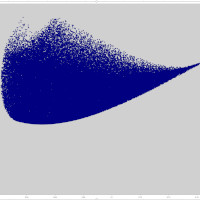
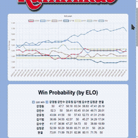
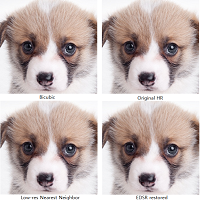
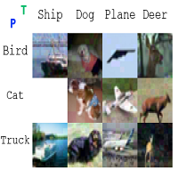
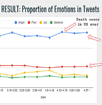

# 강민수 :kr: Minsoo Kang   
## :construction:Now I prefer using my own git server and staying within self-hosted servers. :construction:  
FOSS is good, but my projects has become more private these days for my personal needs.  
~~Rather than trying to expose my works to potential employers~~  
I will still post publically useful codes now and then if I have a sharable one.    

<!--
**Mins0o/Mins0o** is a ✨ _special_ ✨ repository because its `README.md` (this file) appears on your GitHub profile.
-->
---
#### 🖥️⌨️💼🏬🌆 I work at Samsung Electronics in Suwon.  
#### My current hobbies are  
* **self hosting servers (including my own private LLM/SD servers)**  
  * ([alternativeto.net](https://alternativeto.net) is a god-tier website for FOSS),  
* **writing my own markdown journals** (self hosted git server),
* **Learning raw hardware programming (embedded? STM32, EBAZ4205)
* **Raising Plants (local build from source code - seeds!)**
* ...  
  
Arch, ~~NixOS(gives me so much headache)~~, Debian, Fedora, Windows, MacOS user.  
If you were to ask me which OS is the best, I would say all of them.  
🪟Windows, :tokyo_tower:Arch, :apple:Mac, :snowflake:NixOS, :diamond_shape_with_a_dot_inside:TIZEN, everything.  
  
I wish to do more projects about:  
1. Quantum Computing
    * (I took a class about Quantum Computing in KAIST, and participated in a Qiskit Hackathon)  
3. Physical UIs (with MCU and MPUs)
    * (Was in a robot club, and did winter project in a PUI lab in KAIST)  
5. Market Understanding
    * (Minored in business, got some ideas from investment theories)
7. Reinforcement Learning/Game Simulation (More of strategic games than video games)
    * This is just fun.
  
### Education

Highschool : [GSHS](http://gshs-h.gne.go.kr/gshs-h/main.do) (2012 ~ 2014 - 2 years)  
Bachelor : [KAIST](https://kaist.ac.kr/kr/) (2014 ~ 2022)  
- Major#1\_\: [School of Computing](https://cs.kaist.ac.kr/)  
- Major#2\_\: [Mechanical Engineering](http://me.kaist.ac.kr/main/main.html)  
- Minor(1,2)\: [Industrial Design](https://id.kaist.ac.kr/), [College of Business](https://btm.kaist.ac.kr)  
- Club\_\_\_\_\:  MicroRobot Research Club [MR.](https://mr.kaist.ac.kr/) / RC Plane building club **ICARUS**  

Career :  
 - [Samsung Electronics Co.,Ltd. \[AIFW Engineer\] (2022 ~ )](https://www.linkedin.com/in/memesoo-kang/)
   - Computer Vision Application
   - LLM related FWs on Tizen
      - Tizen Actions - a tool to expose apps' apis and OS libraries/modules to LLMs
      - Tizen MCP - An MCP server to expose TV capabilities to LLMs
---
## Projects (Pre-AI Coding! - These are so old now...) 
 
 

  
  
##### To the right from upper left:  
- Visualizing efficient frontier of a portfolio mix
- Match leaderboard with ELO rating/win\_probability calculation  
- Webpage for training, dueling, spectating reinforcement learning agents  
- Haptic Button (Learning about HCI and physical UI - haptics)  
- Image Super Resolution Practice (Learning about SR)  
- Audio recognition door opener for dogs  
- Blackbox adversarial attack improved and expanded - Adding to [DeepSearch](https://dl.acm.org/doi/abs/10.1145/3368089.3409750) - A team project from SBSE course  
- Sentiment analysis on COVID-19 related tweets|Classification and trend analysis - A team project from NLP course  

